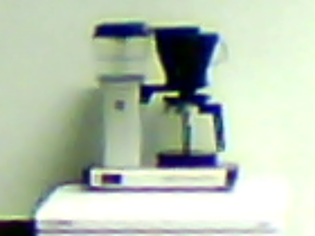
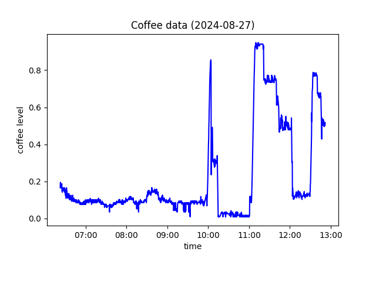

# Coffee Level Bot

A Raspberry Pi camera system that measures how much coffee is left in a Moccamaster pot, turns the readings into a time series and reports it over Telegram. It ran for about a month from July 2024 in the common room of Lateksii ry, the computational engineering students' guild at LUT University.

| Raw camera frame | Daily graph sent by `/graph` |
| --- | --- |
|  |  |

The graph is drawn by `analysis.py` from `testdata.csv`.

## Pipeline

1. **Capture.** A camera on the Raspberry Pi takes a 640×360 frame through OpenCV about every 10 seconds.
2. **Normalise the view.** The frame is rotated and cropped to the coffee maker.
3. **Segment.** k-means colour clustering (k = 3) and global thresholding turn the frame into a binary image where the coffee is dark. A Laplacian edge filter on the binary image gives the outlines.
4. **Locate the pot.** The coffee maker's boundaries are found from the edges, and the pot region is defined relative to them. Frames whose boundaries have an implausible size are rejected.
5. **Measure.** In two vertical strips of the pot, the coffee surface is the lowest row that is no longer mostly dark. The lower of the two readings gives the fill level (0–1), which is smoothed with a running median of the last 10 readings and converted to cups (0–10).
6. **Analyse the series.** A new brew is detected when the level first drops below 15 % and then rises above 20 %. It counts as finished once the level stops rising, and the brew time and cup count are logged. A graph of the day is redrawn every cycle, and the day's readings are archived at midnight. Monthly statistics (number of brews and cups brewed per hour of the day) were computed offline with `analysis.py` and shared with the users manually.

## Telegram commands

The bot's replies are in Finnish. `kahvia` means "coffee".

| Command | Reply |
| --- | --- |
| `/kahvia` | Cups of coffee left and how long ago they were brewed, or that a brew is in progress |
| `/graph` | Today's coffee level graph |
| `/debug` | Network info and the latest cropped camera frame (maintainer only) |

## How to run

```bash
pip install -r requirements.txt
echo "<your bot token>" > tg_bot_token.txt   # or set TELEGRAM_BOT_TOKEN; the file is in .gitignore
python main.py
```

Some parameters are tuned to one camera position and will need adjusting for another setup: rotation and crop in `transform_image()` in `image_processing_library.py`, and the pot region and boundary size limits in `analyse()` in `coffee_library.py`.

## Repository structure

| File | Purpose |
| --- | --- |
| `main.py` | Telegram bot and the measurement loop |
| `coffee_library.py` | Coffee level estimation from one image |
| `image_processing_library.py` | Rotation, cropping, k-means, thresholding and edge filters |
| `analysis.py` | Daily graph and brewing statistics |
| `testdata.csv` | One morning of smoothed readings in the format of `data.csv` |
| `assets/` | Images for this README |
| `notebooks/` | Later experiments with other thresholding methods (Otsu, Niblack, difference of Gaussians, illumination correction) |
| `experiments/` | Early prototypes of the k-means, thresholding and Laplacian steps, and an earlier standalone version of the measurement loop. They come from the project's first repository, and their input images are not included. |

## Context

Personal hobby project, 2024.

## License

MIT
